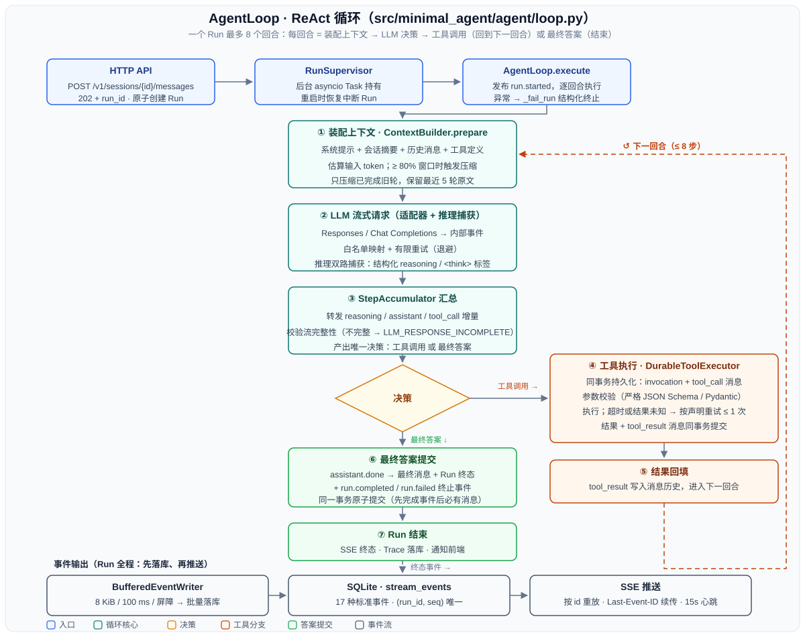
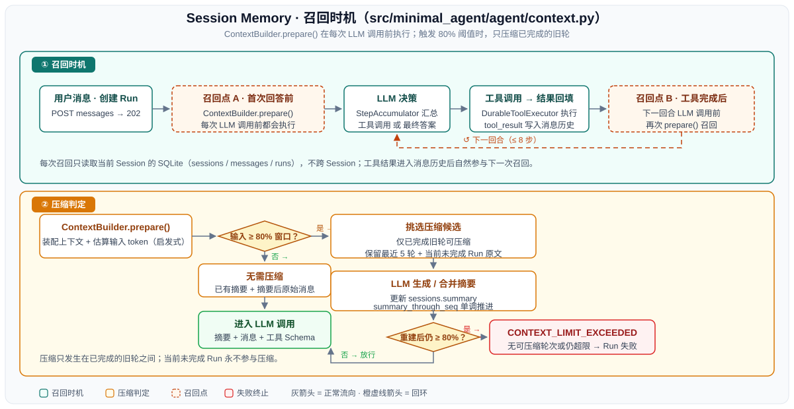
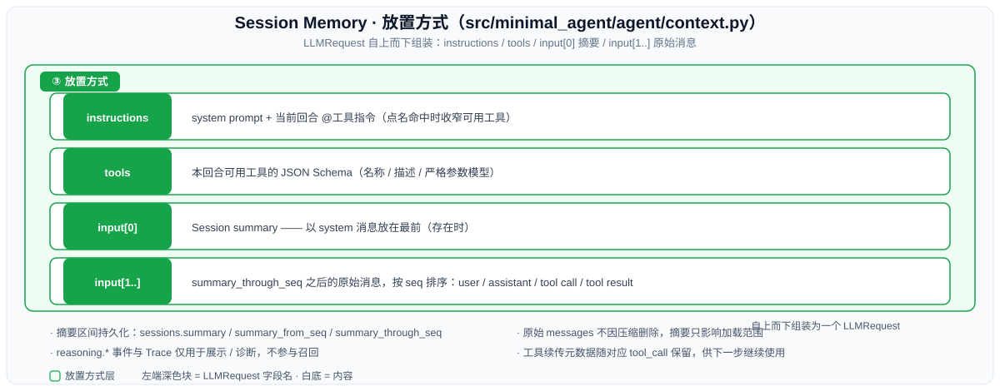
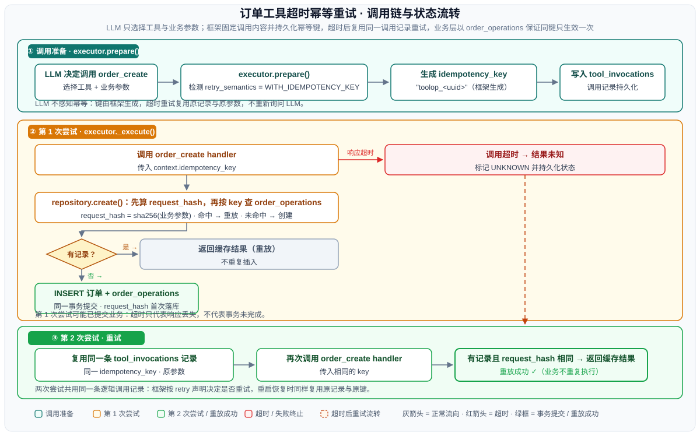

# Minimal Agent

一个不依赖 Agent 框架的最小 ReAct Agent：Python 3.12 + FastAPI + SQLite，前端为
Vue 3 + Vite。支持持久化 Session、流式推理/正文、工具调用、SSE 断线续传和可审计 Trace。

## 运行方式

后端：

```powershell
python -m venv .venv
.venv\Scripts\python -m pip install -e ".[dev]"
Copy-Item .env.example .env
```

编辑 `.env` 时只需填写 `LLM_API_KEY`、`LLM_MODEL`；使用兼容服务时再取消注释并填写
`LLM_BASE_URL`，仅在供应商不支持 Responses 时切换 `LLM_API_STYLE`。示例中的其余配置
均已注释，保持注释即可使用代码默认值。

```powershell
.venv\Scripts\python -m uvicorn minimal_agent.main:app --reload
```

前端（另开终端）：

```powershell
cd frontend
npm install
npm run dev
```

打开 `http://127.0.0.1:5173`；后端健康检查为 `http://127.0.0.1:8000/health`。
当前架构只支持单进程、单 Uvicorn worker。

## 系统设计

```text
Vue / HTTP Client
        │
        ▼
FastAPI ──创建 Session、Message、Run；提供查询与 SSE
        │
        ▼
RunSupervisor ──管理后台 Run
        │
        ▼
AgentLoop（最多 8 步）
   ├─ ContextBuilder：从 SQLite 重建当前 Session 上下文
   ├─ LLM Adapter：Responses / Chat Completions 流式适配
   └─ ToolRegistry：calculator、search、weather、订单 CRUD
        │
        ▼
SQLite：sessions(summary) / messages / runs / tool invocations / events / traces
```

### AgentLoop：ReAct 循环



编号 ①-⑦ 对应 `agent/loop.py` 的执行路径：每回合先由 `ContextBuilder` 装配上下文，再让
LLM 流式输出并由 `StepAccumulator` 汇总出唯一决策；工具调用经 `DurableToolExecutor`
持久化执行后回填结果进入下一回合（最多 8 步），最终答案与 Run 终态在同一事务内提交；
所有回合的事件经 `BufferedEventWriter` 批量落库后由 SSE 推送。

- SQLite 是会话和事件的唯一真源，不依赖远端 `previous_response_id`。
- 每个模型步骤只能产生一个工具调用或一个最终回答；工具结果进入下一步 Context。
- 模型正文、可见推理和工具事件先持久化，再由 SSE 读取；断线可从事件 ID 续传。
- 工具调用先固定参数和幂等键，再按 `safe / with_idempotency_key / never` 语义处理超时重试。
- 同一 Session 同时最多一个 running Run，不同 Session 可以并行。

## Memory：召回时机与放置方式

### 何时召回

`ContextBuilder.prepare()` 在**每次调用 LLM 之前**执行：首次回答前会执行，工具完成后的
下一步也会再次执行。它只读取当前 Session 的 SQLite 数据，不会召回其他 Session。

每次召回后都会估算输入 token：

- 低于模型上下文窗口的 80%：不生成新摘要，直接使用已有摘要和后续原始消息。
- 达到 80%：把可安全压缩的、已经完成的旧轮次合并进摘要；最近 5 个完整轮次和当前
  未完成 Run 保留原文。
- 摘要后仍达到阈值，或没有可压缩轮次：Run 以 `CONTEXT_LIMIT_EXCEEDED` 失败。



### 放到哪里

发给模型的内容按以下位置组织：

```text
LLMRequest.instructions = system prompt + 当前回合的 @工具指令（如有）
LLMRequest.tools        = 本回合可用工具 Schema
LLMRequest.input[0]     = Session summary（存在时，以 system 消息放置）
LLMRequest.input[1..]   = summary_through_seq 之后的原始消息，按 seq 排序
                         （user / assistant / tool call / tool result）
```

摘要正文和覆盖范围保存在 `sessions.summary`、`summary_from_seq`、
`summary_through_seq`；原始 `messages` 不会因摘要而删除。用于展示的 `reasoning.*`
事件保存在 `stream_events`，Trace 只用于诊断，二者都不作为 Session Memory 召回；
工具调用所需的供应商续传元数据仍会随对应 tool call 保留，供紧接着的模型步骤继续使用。



## 架构题：LLM 输出是非确定性的，工具调用可能超时。重试一次工具调用时，怎么保证不产生副作用（比如重复下单）？如何让 agent 框架感知"这个工具是幂等的"？

LLM 输出是非确定性的，所以工具调用超时后，不能让 LLM 再生成一次调用，否则工具参数可能变化。Agent 框架应在第一次调用前保存工具名、参数和调用 ID；重试时直接重放这次调用。对于下单等会产生副作用的工具，框架还要传入同一个幂等键，由订单服务根据该键保证多次请求只创建一笔订单，并在重复请求时返回第一次的结果。这样即使第一次调用已经成功、只是响应超时，重试也不会重复下单。执行器设置的截止时间和 handler 自身报告的超时都按“结果未知”处理，不能把业务提交后的响应丢失降级成普通工具失败。为了让框架知道如何处理，可以在注册工具时声明它的幂等能力和重试策略：查询等可安全重复执行的工具可以直接重试；下单等依赖幂等键的工具只能携带原键和原参数重试；不支持幂等的工具在超时后不能盲目重试，应先查询是否执行成功，无法确认时停止自动重试。



测试该功能文件位置
tests/unit/test_tool_executor.py
执行器重试策略：SAFE 超时重试一次、WITH_IDEMPOTENCY_KEY 复用同一逻辑调用、NEVER 不重试、两次 unknown 终止
tests/unit/test_orders.py
订单 repository 幂等：相同 key 重放返回原记录、不同请求同 key 抛冲突、版本并发冲突
tests/unit/tools/test_orders.py
订单工具层：handler 正确传递幂等键、冲突错误转换
tests/integration/test_tool_recovery.py
进程重启恢复：业务已提交但进程未记录结果时，重建服务图后复用同一幂等键不重复下单
tests/integration/tools/test_agent_orders.py
Agent 端到端：连续两次订单调用结果未知时 Agent 停止


## aicoding文件位置（"aicoding/agent框架搭建.md"）


## 测试覆盖

当前共 29 个测试文件；默认测试不调用付费 LLM。主要覆盖：

- **Agent 核心**（`test_context.py`、`test_agent_loop.py`）：Session 隔离、Context 重建与
  摘要压缩、工具回放、多步 ReAct、推理持久化、错误终止，以及 Supervisor 恢复与清理。
- **LLM 适配**（`tests/unit/llm/`）：Responses/Chat Completions 流映射、推理与
  `<think>` 解析、工具参数组装、模型窗口发现与缓存、有限重试和中断流保护。
- **工具系统**（`test_tool_registry.py`、`test_tool_executor.py`、`tests/unit/tools/`）：严格
  Schema、参数校验、同步/异步执行、超时与幂等恢复，以及 calculator/search/weather/订单。
- **SQLite 持久化**（`test_database.py`、`test_repositories.py`、`test_orders.py`、
  `test_tool_invocations.py`）：事务回滚、消息序列与隔离、Run/事件原子提交、订单幂等与
  乐观锁、工具调用边界原子性。
- **事件流**（`test_streaming.py`、`test_reasoning_history.py`）：8 KiB/100 ms 缓冲、delta
  合并、屏障刷新、SSE 重放与心跳、断线隔离和历史推理重建。
- **HTTP API**（`tests/integration/test_api.py`、`test_orders_api.py`、`test_sse.py`，以及根目录
  `test_health.py`）：完整请求链路、稳定错误、并发约束、重启恢复、OpenAPI 和订单 CRUD。
- **Agent 工具端到端**（`tests/integration/tools/test_agent_*.py`、
  `tests/integration/test_tool_recovery.py`）：工具结果持久化并回传模型、订单完整 CRUD、
  超时不重复写入，以及重建服务后的同调用恢复。
- **契约与真实模型**（`test_tool_contracts.py`、`test_llm_live.py`）：所有注册工具的 Schema、
  副作用/重试声明和测试模块契约；真实模型 smoke/full 流程默认跳过，仅显式开启时运行。

## 文档与验证

- 完整设计：[`docs/design.md`](docs/design.md)
- 部署与故障排查：[`docs/operations.md`](docs/operations.md)
- 当前进度：[`docs/progress.md`](docs/progress.md)
- 项目协作约束：[`AGENTS.md`](AGENTS.md)

```powershell
.venv\Scripts\python -m pytest -ra
.venv\Scripts\python -m ruff check .
.venv\Scripts\python -m ruff format --check .
.venv\Scripts\python -m build
```

